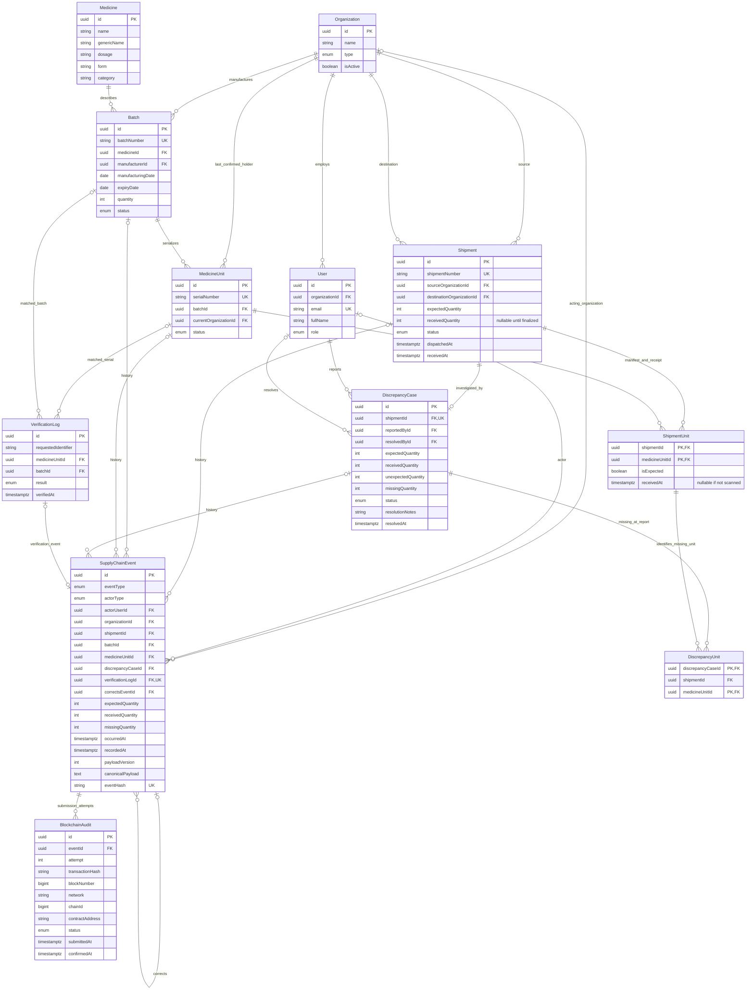

# Pharmaceutical supply chain ER diagram

This is the proposed PostgreSQL design, represented by `backend/prisma/schema.prisma`. No migrations have been applied in this phase. See [DATA_MODEL.md](DATA_MODEL.md) for constraints and lifecycle semantics.

Nullable timestamps and optional references are detailed in the schema. `DiscrepancyUnit` has composite foreign keys to both the case's `(id, shipmentId)` and the shipment unit's `(shipmentId, medicineUnitId)`: a missing unit cannot reference a different shipment accidentally. Transaction hashes are unique per chain; submission attempts are unique per event and attempt number.

The optional verification event relationship allows insertion within one transaction; the later verification service must create exactly one matching event for each completed log. Audit queries can use `(occurredAt, id)` as a stable sort key; this is not a blockchain total-order claim.
